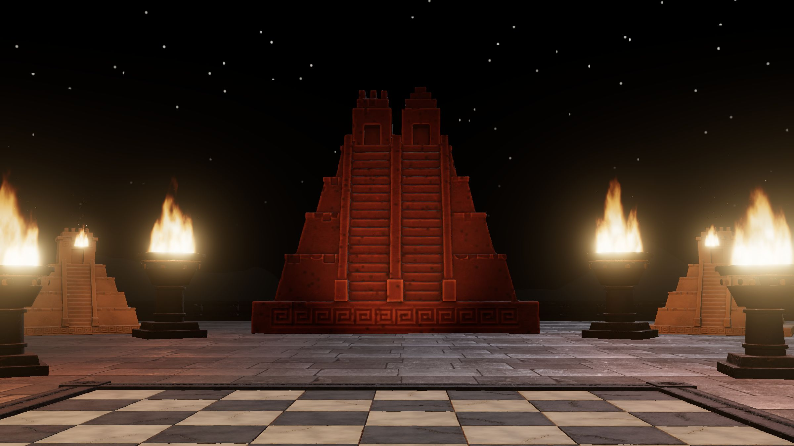

# Mexica Chess

**Play: [mexica-chess.vercel.app](https://mexica-chess.vercel.app)** · [About](https://mexica-chess.vercel.app/about)

A chess set carved in volcanic stone, played in 3D in the browser: red tezontle against black basalt, on the plaza of Tenochtitlan or on a temple above the forest of Calakmul. An experiment by [Alia Studio](https://alia.studio) — make a game, model it in Blender, build it in 3D, make it fun, with design that feels Mexican in its material.



What's in it: every piece carved by a Python script in Blender and baked onto a light model; captures that break the piece into pre-fractured chunks and crack the slab beneath it; a cinematic camera, slow motion and real CC0 foley; Stockfish 19 in the browser; two players on one screen with the board turning; night and golden hour; walking the board on foot; and 26 lessons to learn the game, each checked with the engine. The story is on the [About page](https://mexica-chess.vercel.app/about).

## Run it

```sh
npm install
npm run dev          # http://localhost:3100
npm run build        # dist/: the game and /about
```

## The stone (Blender 5.2, headless)

```sh
python3 blender/fetch.py                                      # CC0 scans from Poly Haven, once
npm run piece -- rook                                         # sculpt → retopo → bake → public/models
blender -b --factory-startup -P blender/fracture.py -- king   # pre-fracture a piece for captures
blender -b --factory-startup -P blender/damage.py -- 0        # broken slabs (morph target + thrown bits)
```

`blender/kit.py` holds the shared pipeline: union the masses (voxel remesh), cut the reliefs and edge chips (booleans), soften and weather, decimate, UV, then bake colour, roughness, normal and ambient occlusion from a procedural stone built on recoloured scans. `blender/pieces/*.py` only describe shapes.

## Checks

```sh
node scripts/lessons.mjs        # every lesson: legal, solvable, the engine agrees
node scripts/jank.mjs           # frame gaps, long tasks and shader compiles around clicks and captures
node scripts/click.mjs <dir>    # real clicks on projected squares
node scripts/learn.mjs <dir>    # learn mode end to end, desktop and phone
node scripts/smoke.mjs <dir> <url>   # a deployed build: ready time, a move, /about
```

More in [docs/PLAN.md](docs/PLAN.md).

## Licences

- **Stockfish 19** (WebAssembly build by Nathan Rugg): GNU GPL v3, shipped with its licence in `public/engine/`. Source: [official-stockfish/Stockfish](https://github.com/official-stockfish/Stockfish), [nmrugg/stockfish.js](https://github.com/nmrugg/stockfish.js).
- **Sounds**: CC0, from Freesound and Kenney — every file and its author in `public/audio/CREDITS.txt`.
- **Stone scans**: CC0, [Poly Haven](https://polyhaven.com) (rock_05, dark_rock, large_grey_tiles, mossy_sandstone).
- **Fonts**: Funnel Display, Funnel Sans, Fragment Mono — Google Fonts, SIL Open Font License.
- **This code and the Blender scripts**: no licence has been chosen yet.
